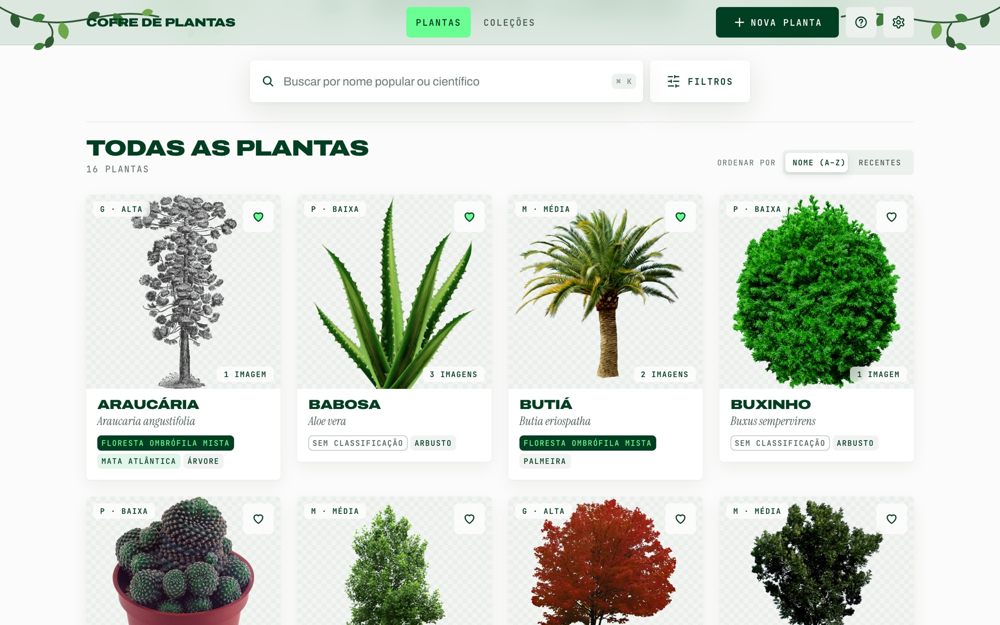
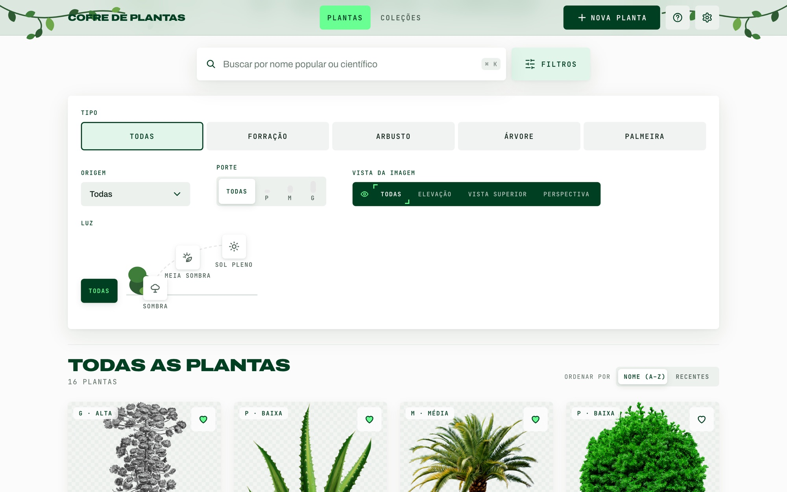
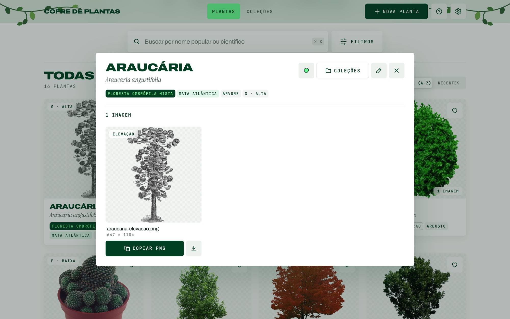
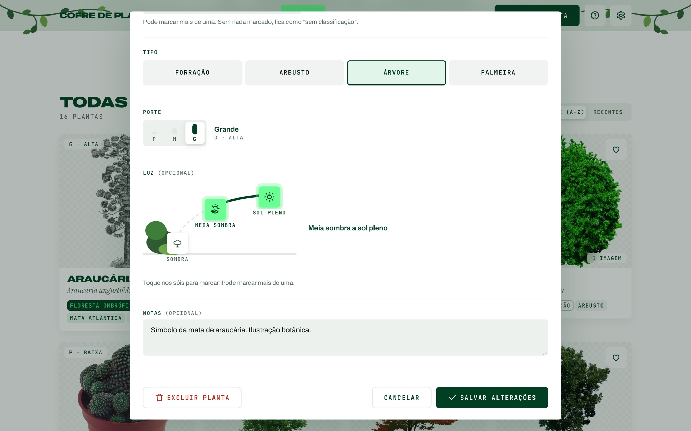
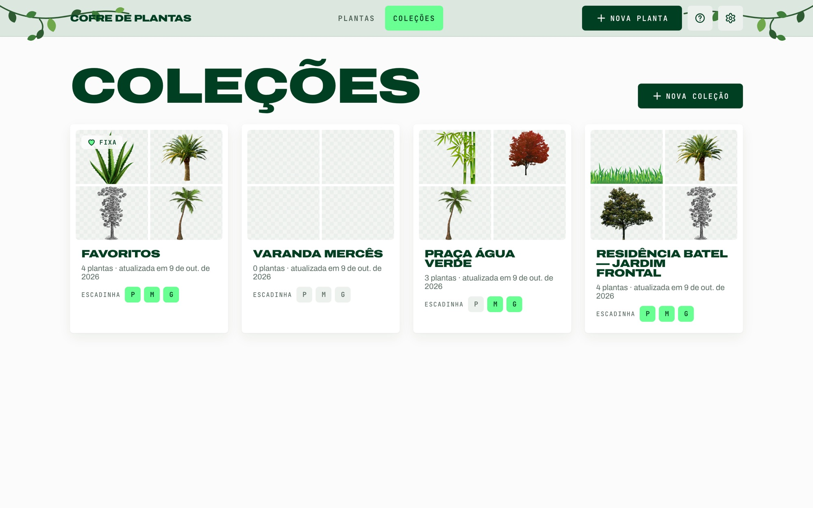

# Botanical Vault · Backend

A private cloud library of transparent plant PNGs for architectural collages. Search and filter species by native biome, type, size, light and image view, then copy a PNG straight into Photoshop or download it.
Plants are grouped into project collections that show whether the small/medium/large "staircase" is covered. This repo is the Spring Boot REST API; the interface lives in [botanical-vault-frontend](https://github.com/amalra1/botanical-vault-frontend).

